# 02. 웹 개발 심화 1 — JS DOM 인터랙션

JavaScript로 DOM을 조작하고 이벤트를 처리하는 미니 기능 4개를 한 페이지에 구현

## 결과물

- GitHub: https://github.com/r1nn-dev/spring-backend-bootcamp/tree/main/09-coursework/99-missions/01-js-dom-interactions
- Firebase: https://r1nn-js-dom-a5224.web.app

## 과제

한 페이지(`index.html` / `style.css` / `script.js`)에 과제별 섹션을 하나씩 추가하고, 과제마다 커밋 1개로 남겼다.

| 번호 | 내용 | 커밋 | 구현 요약 |
| --- | --- | --- | --- |
| 2-1 | (JS DOM) 버튼 클릭으로 텍스트와 인사 출력 | [`ea6c901`](https://github.com/r1nn-dev/spring-backend-bootcamp/commit/ea6c901) | 입력한 이름으로 `Hello, [이름]` 출력 (빈 입력 안내, `textContent`로 안전하게 출력) |
| 2-2 | (JS DOM) 모달 창 구현 | [`f79096d`](https://github.com/r1nn-dev/spring-backend-bootcamp/commit/f79096d) | 버튼 클릭 시 `classList.add`로 모달 표시, 닫기 버튼·배경 클릭·Esc로 `classList.remove` 숨김 |
| 2-3 | (JS) 구구단 출력기 | [`1542bb6`](https://github.com/r1nn-dev/spring-backend-bootcamp/commit/1542bb6) | 조건문+반복문+함수 종합 활용 완료 |
| 2-4 | (JS DOM) 이미지 효과 및 다크모드 토글 | [`fbbdcfa`](https://github.com/r1nn-dev/spring-backend-bootcamp/commit/fbbdcfa) | `mouseover`/`mouseout`으로 낮↔밤 이미지 교체, `classList.toggle`로 CSS 변수 기반 다크모드 전환 |

- 2-3 근거: 조건문은 `validateDan()`의 `if / else if`(빈 값·정수·범위 검사), 반복문은 `createTimesTable()`의 `for`(1~9 계산)와 `for...of`(목록 생성), 함수는 검증·계산·출력 3개로 역할 분리

## 스크린샷

### 2-1. 인사 출력

| 이름 입력 후 클릭 | 빈 입력 | 태그 입력 (글자 그대로 출력) |
| --- | --- | --- |
| 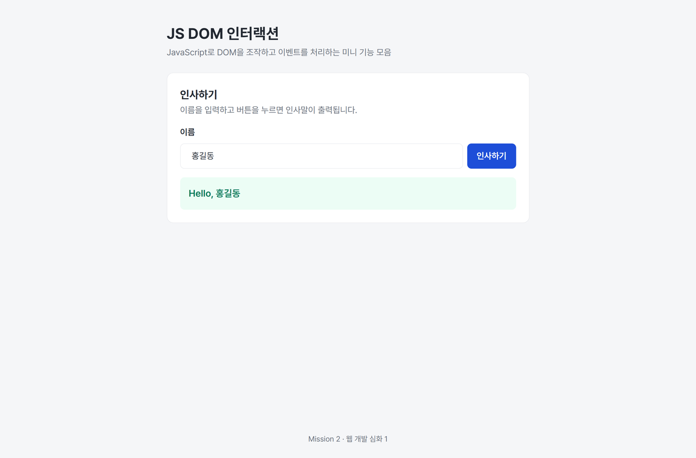 | 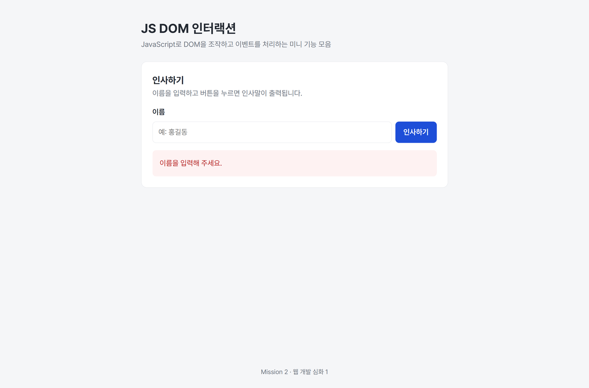 | 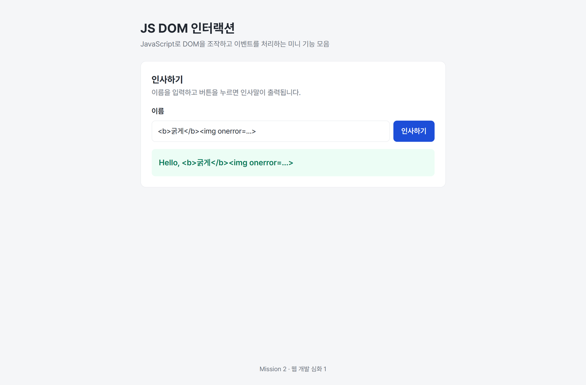 |

### 2-2. 모달

| 열기 전 | 열린 상태 | 닫은 후 |
| --- | --- | --- |
| 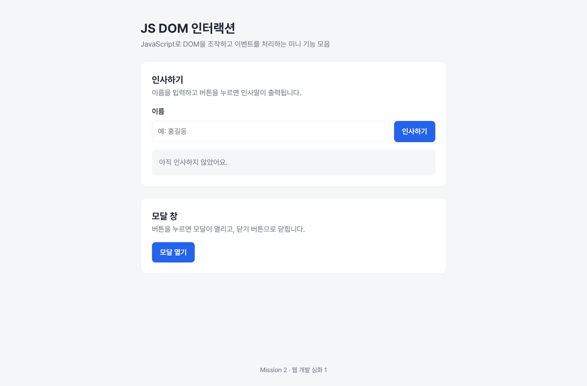 | 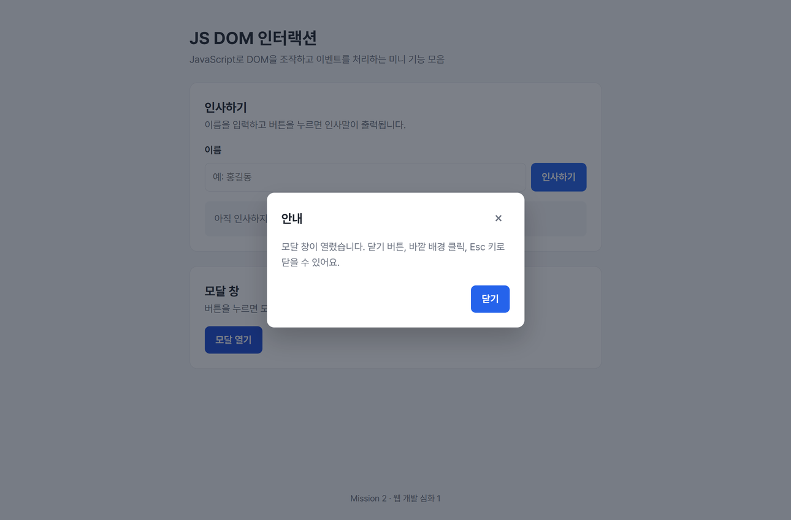 |  |

### 2-3. 구구단

| 정상 입력 (5) | 범위 밖 입력 (0) |
| --- | --- |
| 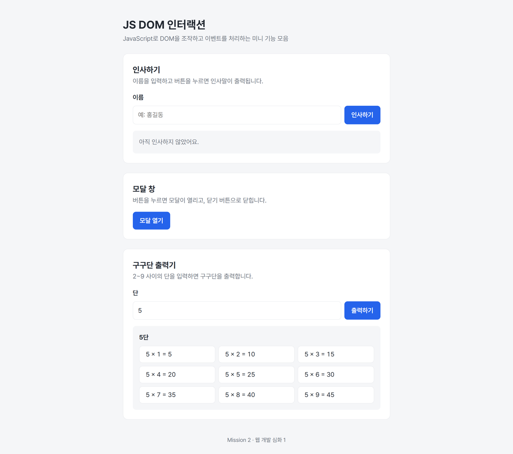 | 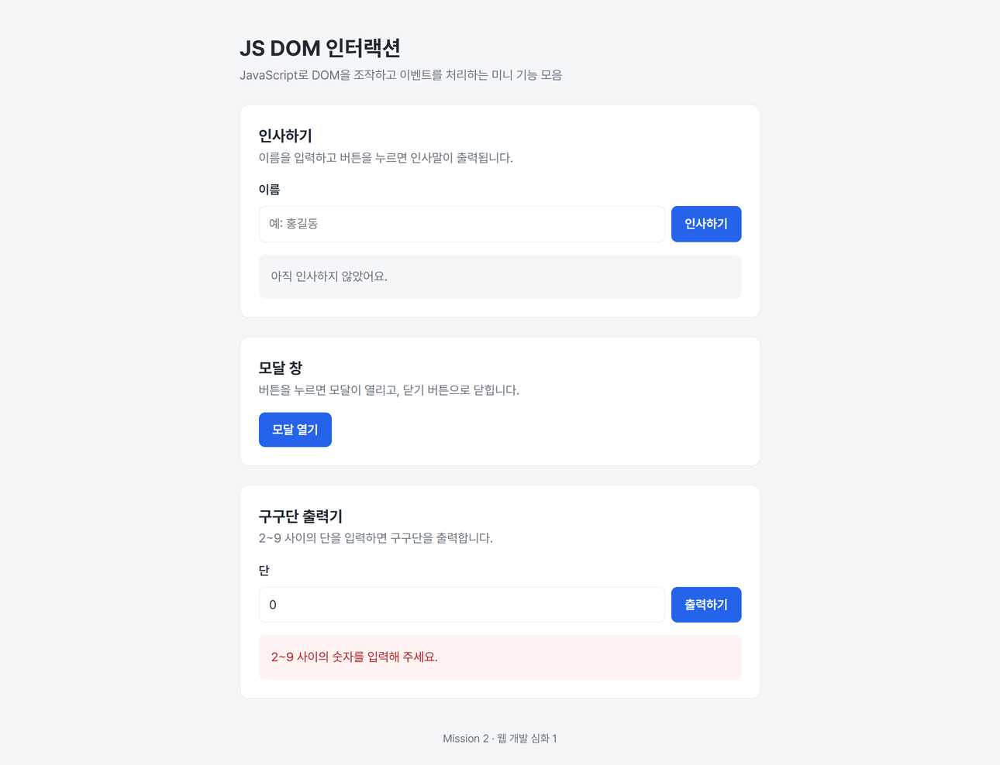 |

### 2-4. 이미지 효과 · 다크모드

| 마우스 오버 전 | 마우스 오버 중 |
| --- | --- |
| 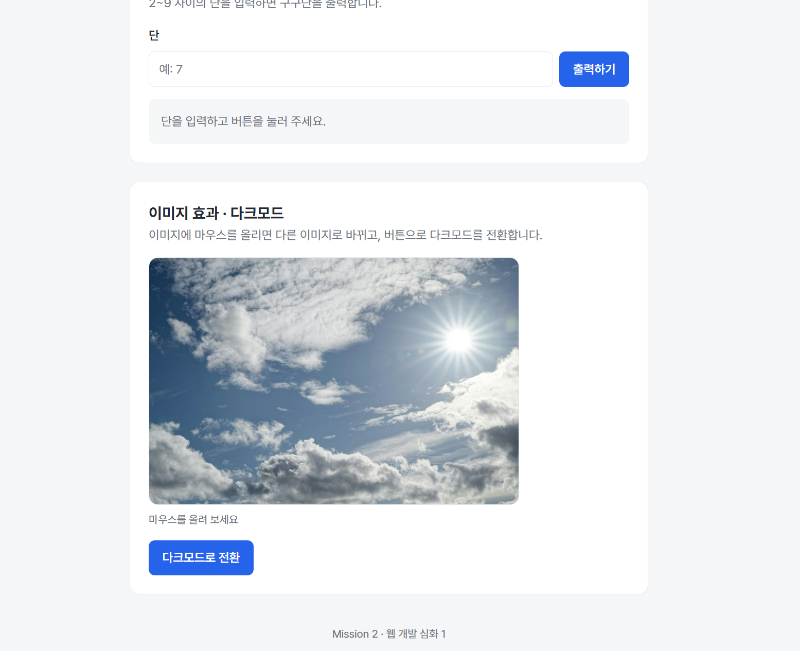 | 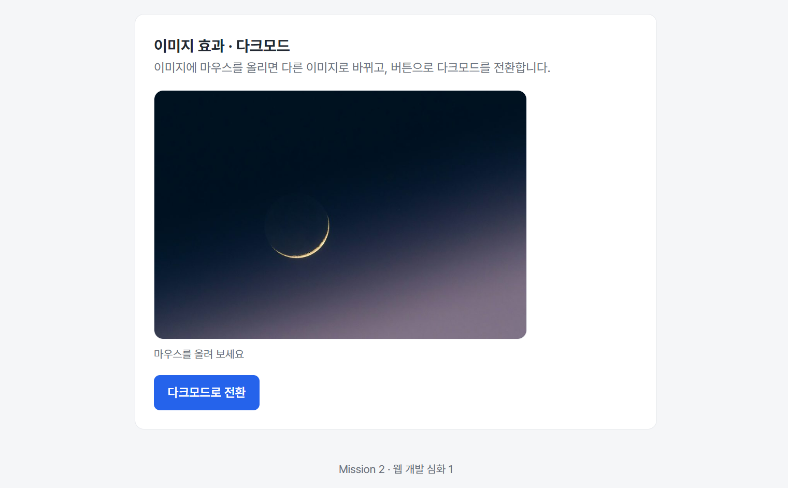 |

| 라이트모드 | 다크모드 |
| --- | --- |
| 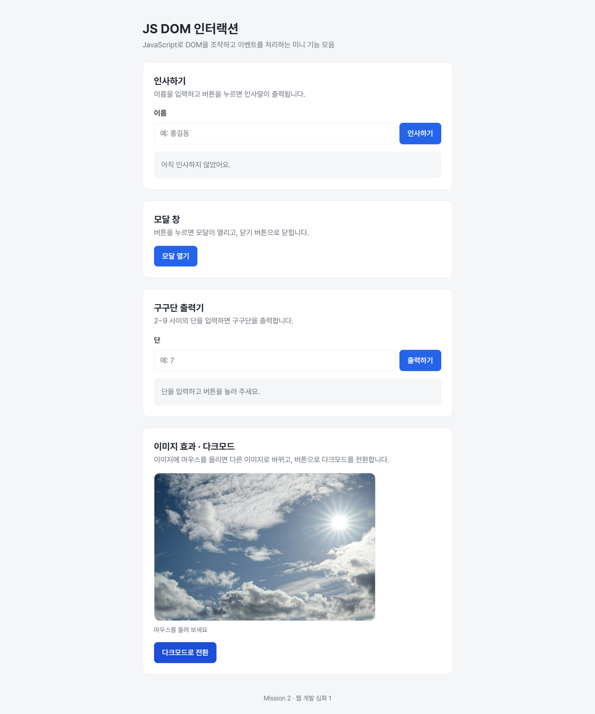 | 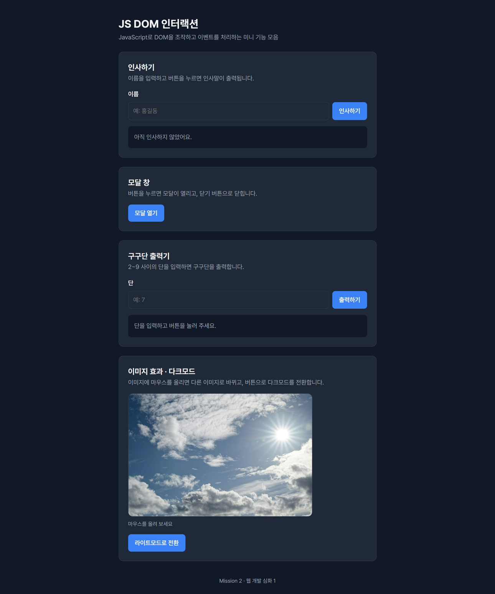 |

## 구조

```
body (grid: header / main / footer)
├── header.site-header
├── main.container
│   ├── section#greeting      2-1 인사 출력
│   ├── section#modal-demo    2-2 모달 열기 버튼
│   ├── section#times-table   2-3 구구단
│   └── section#effects       2-4 이미지 효과 · 다크모드 버튼
├── footer.site-footer
└── div#modal                 2-2 모달 (기본 숨김)
```

- `script.js`는 과제마다 `setupXxx()` 함수 하나로 나누고, 마지막에 차례로 호출한다.
- 색은 모두 CSS 변수로 정의하고, 다크모드는 `body.dark`에서 변수 값만 바꾼다.

## 파일

| 파일 | 설명 |
| --- | --- |
| `index.html` | 페이지 마크업 (섹션 4개 + 모달) |
| `style.css` | 디자인 변수(라이트/다크), 공통 컴포넌트, 과제별 스타일, 반응형 |
| `script.js` | `setupGreeting()`, `setupModal()`, `validateDan()`·`createTimesTable()`·`setupTimesTable()`, `setupImageHover()`, `setupThemeToggle()` |
| `images/` | 2-4 마우스 오버용 사진 (낮 하늘 / 밤하늘, 960×640) |
| `screenshots/` | 과제별 실행 화면 |
| `firebase.json` | Firebase Hosting 설정 (`README.md`, `screenshots/`는 배포 제외) |

## 이미지 출처

- `images/day.jpg`, `images/night.jpg`: [Unsplash](https://unsplash.com/ko) ([Unsplash License](https://unsplash.com/ko/license), 960×640으로 잘라 줄여 사용)

## 실행 · 배포

```bash
# 로컬: index.html을 VS Code Live Server로 열기

# 배포 (이 폴더에서)
firebase deploy --only hosting
```
