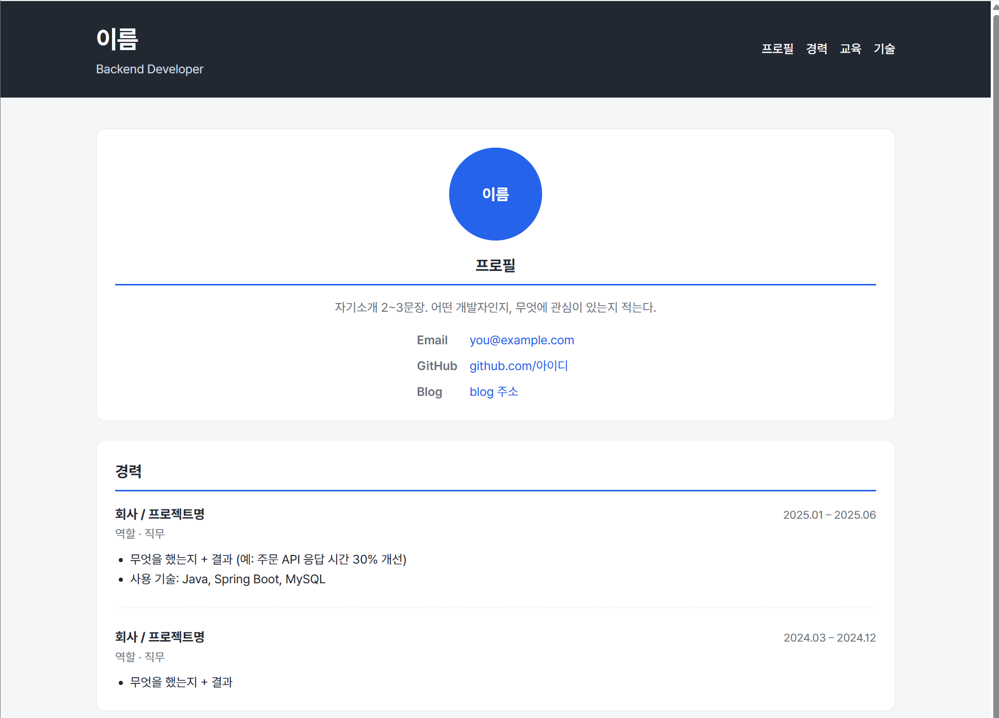
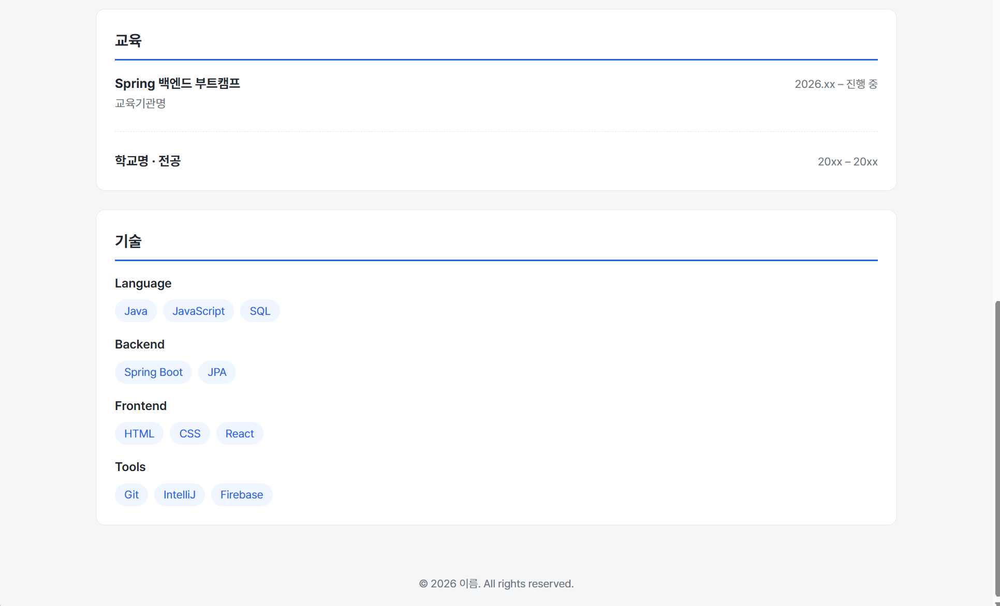
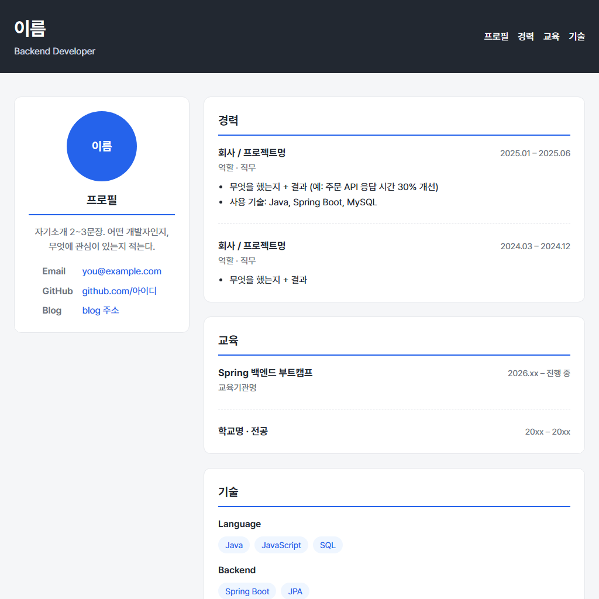
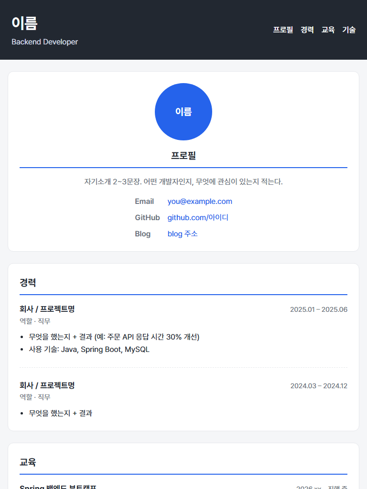
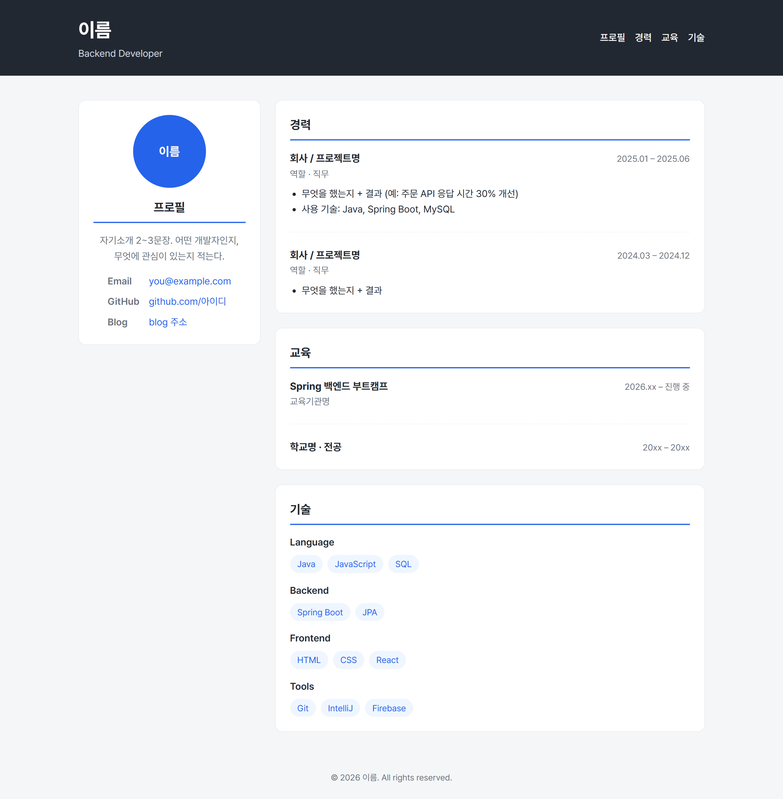
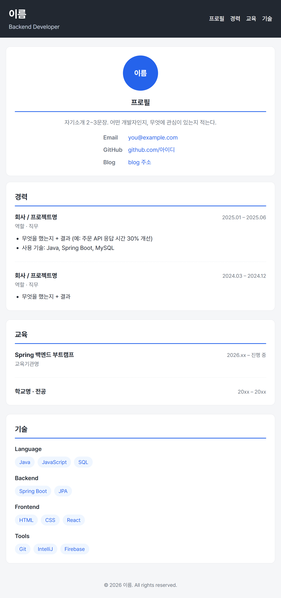
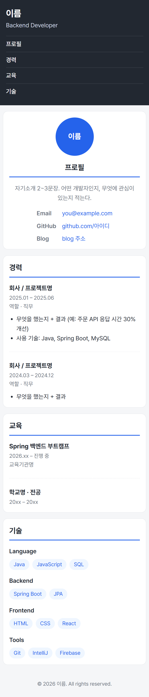

# 01. 웹 개발 기초 — 이력서 페이지

HTML, CSS로 이력서 웹페이지를 만들고 Grid·@media로 반응형을 단계적으로 적용

## 결과물

- GitHub: https://github.com/r1nn-dev/spring-backend-bootcamp/tree/main/09-coursework/99-missions/01-resume-page
- Firebase: https://r1nn-resume-be62f.web.app

## 과제

하나의 `index.html` / `style.css`를 1-3 → 1-1 → 1-2 순서로 발전시키고, 과제마다 커밋 1개로 남겼다.

| 진행 순서 | 번호 | 내용 | 커밋 | 구현 요약 |
| --- | --- | --- | --- | --- |
| 1 | 1-3 | 이력서 웹페이지 (header/main/footer) | [`c9b43a7`](https://github.com/r1nn-dev/spring-backend-bootcamp/commit/c9b43a7) | 프로필~기술까지 섹션 구성 완료 |
| 2 | 1-1 | CSS Grid 반응형 이력서 레이아웃 | [`aa5c09b`](https://github.com/r1nn-dev/spring-backend-bootcamp/commit/aa5c09b) | Grid 사용하여 이력서 구조 정렬 완료 |
| 3 | 1-2 | @media 쿼리 반응형 디자인 | [`05f41d7`](https://github.com/r1nn-dev/spring-backend-bootcamp/commit/05f41d7) | 모바일에서는 컬럼 → 행으로 변경됨 |

## 스크린샷

### 1-3. 이력서 웹 페이지

| 상단 | 하단 |
| --- | --- |
|  |  |

### 1-1. CSS Grid 레이아웃

| 1024px (2열) | 768px (1열) |
| --- | --- |
|  |  |

### 1-2. 반응형 웹 디자인

| 데스크탑 | 태블릿 (iPad Mini) | 모바일 (iPhone SE) |
| --- | --- | --- |
|  |  |  |

## 구조

```
body (grid: header / main / footer)
├── header.site-header      이름 · 직무 · nav
├── main.container          grid-container (프로필 | 본문)
│   ├── section#profile     프로필 · 연락처
│   └── div.content         경력 · 교육 · 기술
└── footer.site-footer
```

## 반응형 브레이크포인트

| 뷰 | 조건 | 레이아웃 |
| --- | --- | --- |
| 데스크탑 | 1024px 이상 | 2열 (프로필 240~300px + 본문) |
| 태블릿 | `max-width: 1023px` | 2열 유지, 여백·글자·아바타 축소 |
| 태블릿(세로) | `max-width: 768px` | 1열 |
| 모바일 | `max-width: 480px` | 메뉴 세로 정렬, 폰트 축소, 항목 제목·기간 세로 배치 |

## 파일

| 파일 | 설명 |
| --- | --- |
| `index.html` | 이력서 마크업 |
| `style.css` | 기본 스타일, Grid 레이아웃, 반응형 미디어 쿼리 |
| `404.html` | Firebase Hosting 기본 404 페이지 |
| `firebase.json`, `.firebaserc` | Firebase Hosting 설정 (`README.md`, `screenshots/`는 배포 제외) |
| `screenshots/` | 과제별 산출물 스크린샷 (자리표시자 내용 상태) |

## 실행 · 배포

```bash
# 로컬: index.html을 VS Code Live Server로 열기

# 배포 (이 폴더에서)
firebase deploy --only hosting
```
