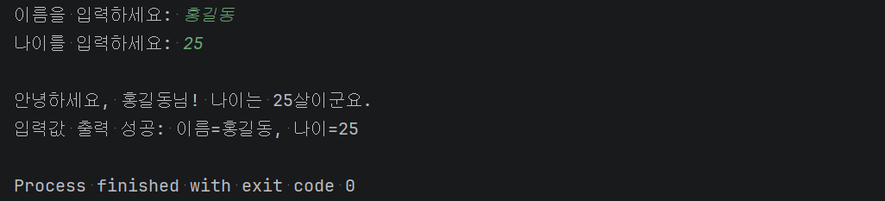
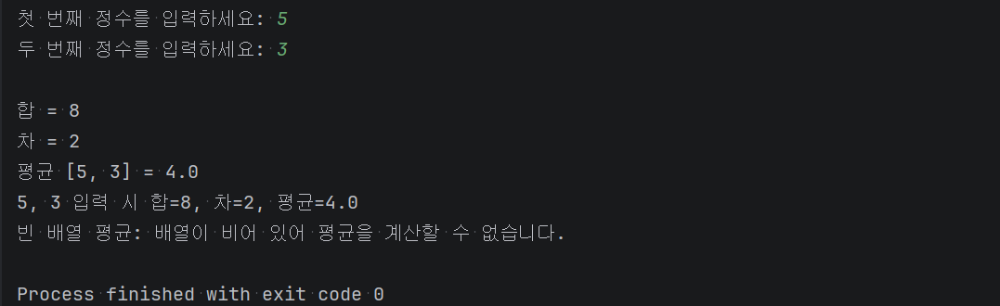
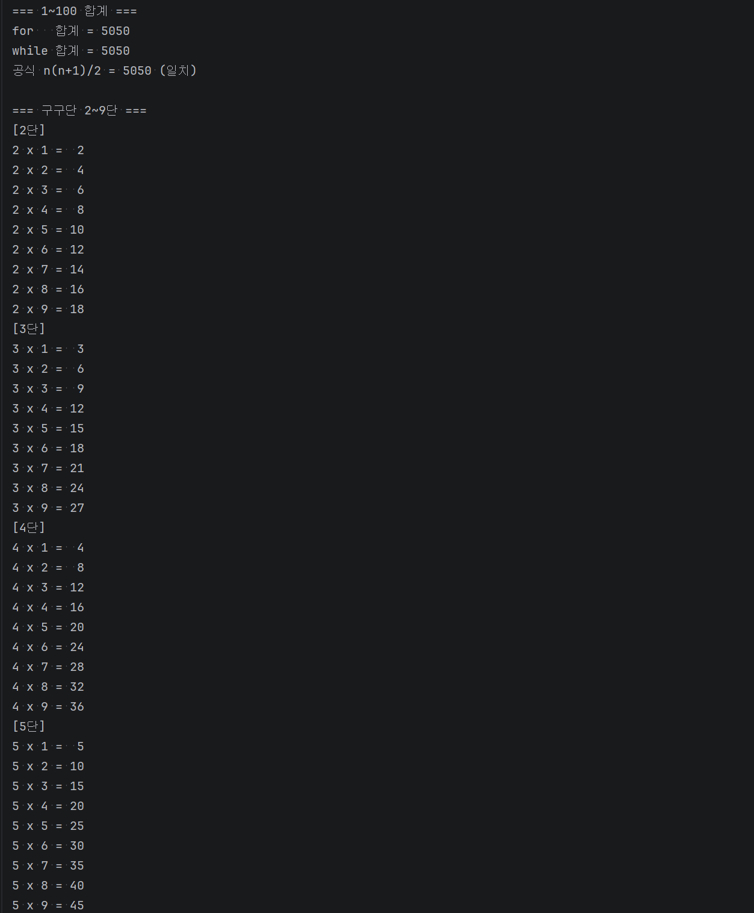
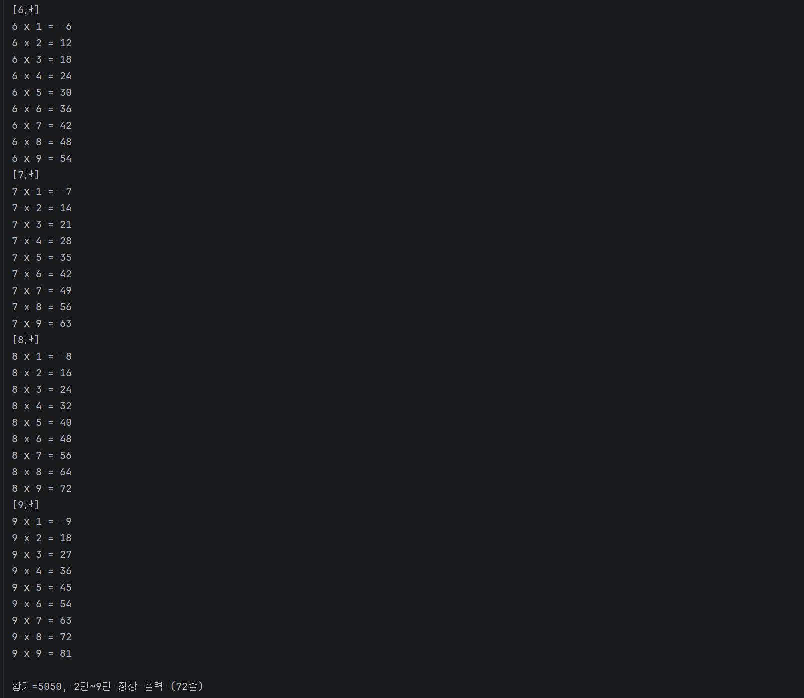
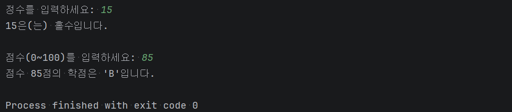
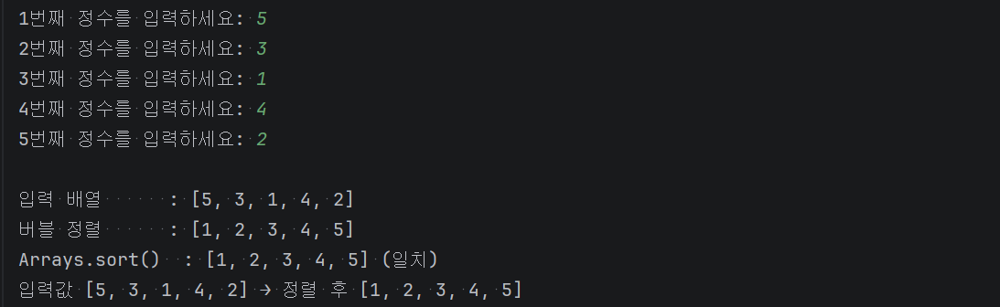

# 04. Java 기초 — 입출력·메서드·반복문·조건문·배열

Java로 사용자 입력을 받아 연산·분기·반복·정렬을 처리하는 콘솔 프로그램 5개를 작성

## 결과물

- GitHub: https://github.com/r1nn-dev/spring-backend-bootcamp/tree/main/09-coursework/99-missions/02-java-basics

## 과제

과제 하나 = `.java` 파일 하나 = 커밋 하나. 파일끼리 의존하지 않고 각각 단독 실행한다.

| 번호 | 내용 | 파일 | 커밋 | 실행 결과 요약 |
| --- | --- | --- | --- | --- |
| 4-1 | (Java) 입력과 출력 기본 실습 | `InputOutput.java` | [`5b81f45`](https://github.com/r1nn-dev/spring-backend-bootcamp/commit/5b81f45) | 입력값 출력 성공: 이름=홍길동, 나이=25 |
| 4-2 | (Java) 메서드 활용 프로그램 | `MethodPractice.java` | [`0bf1a67`](https://github.com/r1nn-dev/spring-backend-bootcamp/commit/0bf1a67) | 5, 3 입력 시 합=8, 차=2, 평균=4.0 |
| 4-3 | (Java) 반복문 활용 프로그램 | `LoopPractice.java` | [`4155333`](https://github.com/r1nn-dev/spring-backend-bootcamp/commit/4155333) | 합계=5050, 2단~9단 정상 출력 (72줄) |
| 4-4 | (Java) 조건문 활용 프로그램 | `ConditionPractice.java` | [`2de7744`](https://github.com/r1nn-dev/spring-backend-bootcamp/commit/2de7744) | 15 입력 시 '홀수', 점수 85 입력 시 'B' 출력 확인 |
| 4-5 | (Java) 배열과 정렬 실습 | `ArraySort.java` | [`c23cc0b`](https://github.com/r1nn-dev/spring-backend-bootcamp/commit/c23cc0b) | 입력값 [5, 3, 1, 4, 2] → 정렬 후 [1, 2, 3, 4, 5] |

## 구현 포인트

| 번호 | 내용 |
| --- | --- |
| 4-1 | `Scanner`를 `try-with-resources`로 닫는다. 모든 입력을 `nextLine()`으로 읽고 나이만 `Integer.parseInt()`로 변환해 `nextInt()` 뒤 줄바꿈이 남는 문제를 피했다. 빈 이름, 숫자가 아닌 나이, 0~150 밖의 나이는 안내 후 다시 입력받는다 |
| 4-2 | `sum`·`difference`·`average`는 입출력 없이 값을 받아 반환만 한다. 평균은 입력한 두 정수로 만든 배열 `{a, b}`로 계산한다. 합계는 `long`에 모으고 `(double)`로 나눠 정수 나눗셈을 피한다. 빈 배열은 `IllegalArgumentException`을 던지고 `main`에서 안내 문구로 바꾼다 |
| 4-3 | 1~100 합계를 `for`와 `while`로 각각 구하고 공식 `n(n+1)/2`와 비교한다. 구구단은 중첩 `for`(단 2~9 × 곱하는 수 1~9)로 출력하고 `%2d`로 자리를 맞춘다. 출력 줄 수(72줄)도 함께 보여준다 |
| 4-4 | 짝홀은 `if/else`, 학점은 `switch` 화살표 문법(`score / 10`)으로 나눴다. 음수 홀수(`-3 % 2 == -1`)도 맞게 판별하도록 `% 2 == 0`으로 비교한다. 0~100 밖의 점수는 안내 후 다시 입력받는다. 학점 기준: 90↑ A, 80↑ B, 70↑ C, 60↑ D, 그 외 F |
| 4-5 | `for`로 정수 5개를 `int[5]`에 저장한다. 버블 정렬(교환이 없으면 조기 종료)을 직접 구현하고 `Arrays.sort()` 결과와 `Arrays.equals()`로 비교한다. 원본은 `clone()` / `Arrays.copyOf()` 복사본을 정렬해서 그대로 보존한다 |

## 확인한 입력

| 번호 | 입력 | 결과 |
| --- | --- | --- |
| 4-1 | 공백 포함 이름, 빈 이름, 나이 `abc` / `-1` | 공백 그대로 출력, 나머지는 안내 후 다시 입력 |
| 4-2 | 3, 5 / 빈 배열 / 정수 자리에 `x` | 차=-2 / 안내 문구 / 다시 입력 |
| 4-4 | 4, 7, 0, -3 / 점수 90, 89, 60, 59, 100, 0 / 101, -1 | 짝·홀·짝·홀 / A·B·D·F·A·F / 범위 안내 |
| 4-5 | 중복 (3 1 3 2 1) / 음수 (0 -5 10 -1 3) / 숫자 아닌 값 | `[1, 1, 2, 3, 3]` / `[-5, -1, 0, 3, 10]` / 다시 입력 |

## 스크린샷

### 4-1. 입력과 출력



### 4-2. 메서드



### 4-3. 반복문





### 4-4. 조건문



### 4-5. 배열과 정렬



## 파일

| 파일 | 설명 |
| --- | --- |
| `InputOutput.java` | 4-1 — `readName()`, `readAge()` (검증·재입력) |
| `MethodPractice.java` | 4-2 — `sum()`, `difference()`, `average()` |
| `LoopPractice.java` | 4-3 — for/while 합계, 중첩 for 구구단 |
| `ConditionPractice.java` | 4-4 — `evenOrOdd()`, `grade()`, `readScore()` |
| `ArraySort.java` | 4-5 — `bubbleSort()`, `Arrays.sort()` 비교 |
| `screenshots` | 과제별 실행 화면 |

## 실행

JDK 21 기준. 패키지 선언 없이 클래스 이름 = 파일 이름이라 컴파일 없이 바로 실행된다 (Java 11+ 단일 파일 실행).

```bash
cd 09-coursework/99-missions/02-java-basics
java InputOutput.java
java MethodPractice.java
java LoopPractice.java
java ConditionPractice.java
java ArraySort.java
```
