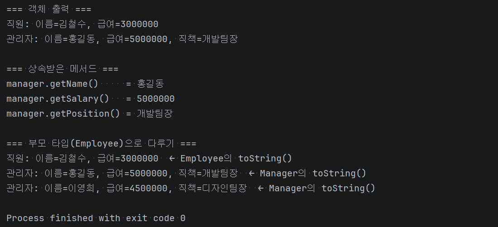
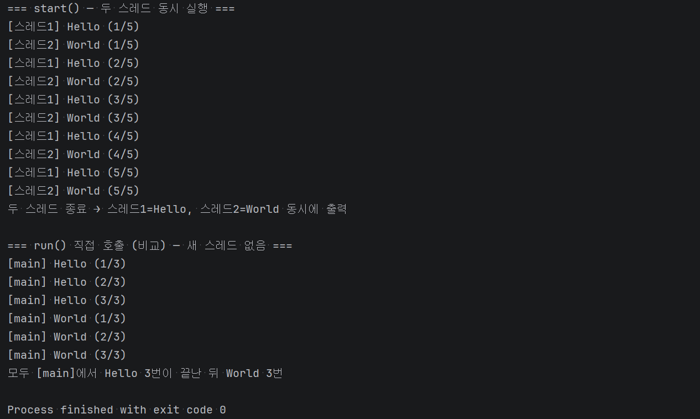
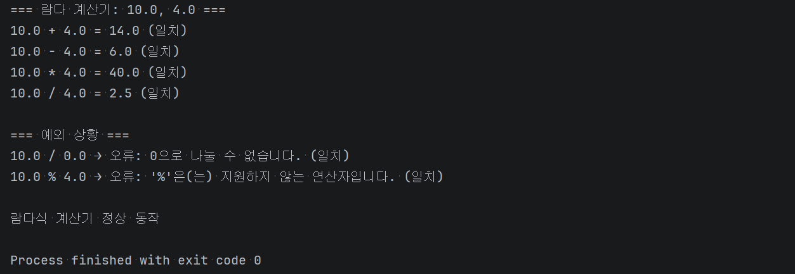
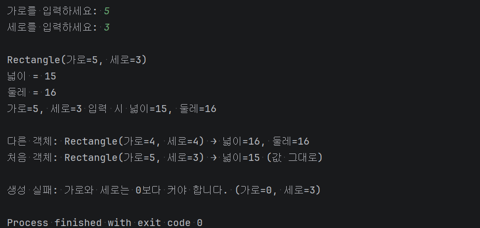
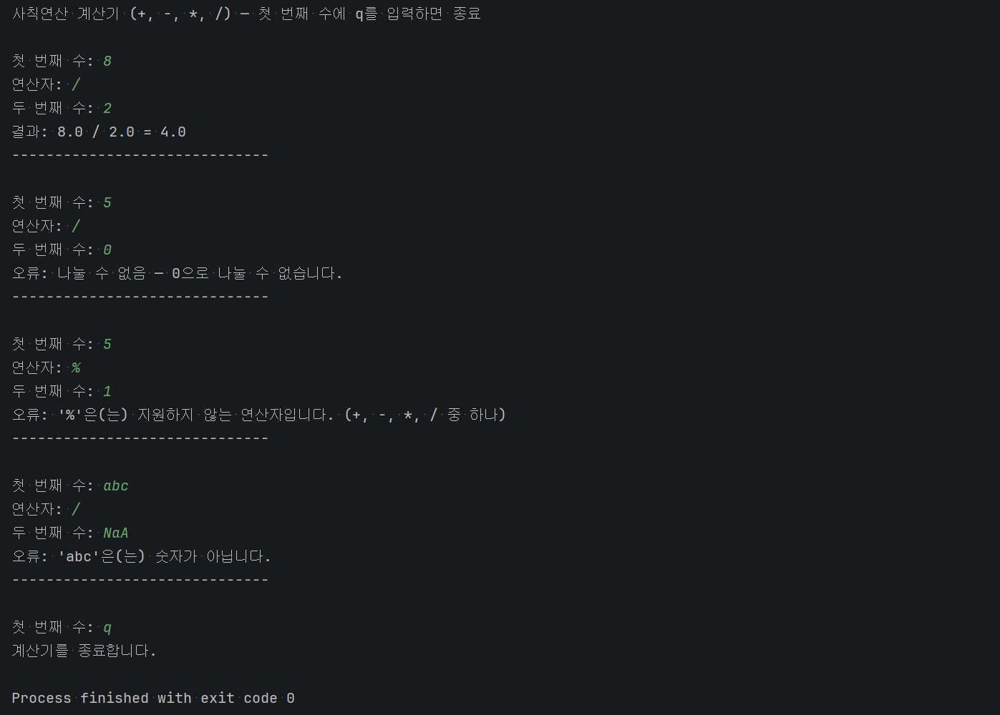
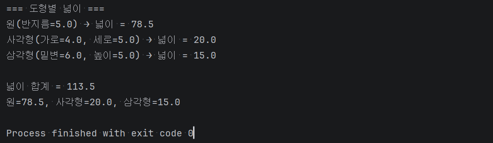

# 05. Java 중급 — 클래스·상속·인터페이스·예외·스레드·람다

Java로 클래스 설계(캡슐화·상속·인터페이스), 예외 처리, 스레드, 람다 표현식을 다루는 콘솔 프로그램 5개를 작성

## 결과물

- GitHub: https://github.com/r1nn-dev/spring-backend-bootcamp/tree/main/09-coursework/99-missions/02-java-oop

## 과제

과제 하나 = 하위 폴더(패키지) 하나. 클래스는 파일 하나에 하나씩 두고, 과제마다 코드 커밋과 캡쳐 커밋을 따로 남겼다.
번호는 미션 원문 순서이고, 작업은 의존 관계에 따라 5-3 → 5-1 → 5-5 → 5-4 → 5-2 순서로 했다.

| 번호 | 내용 | 폴더 | 커밋 | 실행 결과 요약 |
| --- | --- | --- | --- | --- |
| 5-1 | 상속과 메서드 오버라이딩 | `inheritance/` | [`dfb845e`](https://github.com/r1nn-dev/spring-backend-bootcamp/commit/dfb845e) | 관리자: 이름=홍길동, 급여=5000000, 직책=개발팀장 |
| 5-2 | 스레드와 람다 | `concurrency/` | [`a9f8388`](https://github.com/r1nn-dev/spring-backend-bootcamp/commit/a9f8388) · [`346962a`](https://github.com/r1nn-dev/spring-backend-bootcamp/commit/346962a) | 스레드1=Hello, 스레드2=World 동시에 출력 / 람다식 계산기 정상 동작 |
| 5-3 | 클래스와 객체 (직사각형) | `rectangle/` | [`fa15ff0`](https://github.com/r1nn-dev/spring-backend-bootcamp/commit/fa15ff0) | 가로=5, 세로=3 입력 시 넓이=15, 둘레=16 |
| 5-4 | 예외 처리 계산기 | `exception/` | [`4f5d1c5`](https://github.com/r1nn-dev/spring-backend-bootcamp/commit/4f5d1c5) | 0으로 나눌 경우 '나눌 수 없음' 메시지 출력, 잘못된 연산자·숫자 아닌 입력 안내 |
| 5-5 | 인터페이스와 다형성 (도형) | `shape/` | [`7854921`](https://github.com/r1nn-dev/spring-backend-bootcamp/commit/7854921) | 원=78.5, 사각형=20.0, 삼각형=15.0 |

## 구현 포인트

| 번호 | 내용 |
| --- | --- |
| 5-1 | `Manager extends Employee`로 이름·급여를 물려받고 직책을 추가했다. 생성자에서 `super(name, salary)`로 부모 필드를 초기화한다. 두 클래스 모두 `@Override toString()`. 부모 필드는 `private final`로 두고 자식은 getter로 읽는다. `Employee[]`에 직원·관리자를 섞어 담아도 실제 객체의 `toString()`이 실행된다 (동적 바인딩) |
| 5-2 | `MessageTask implements Runnable`로 작업을 만들고 스레드 2개를 `start()` → `join()`으로 실행한다. `Thread.sleep()`으로 출력이 섞이는 것을 보이고, 비교용으로 `run()`을 직접 호출하면 `[main]`에서 순서대로 실행되는 것도 보여준다. 람다 계산기는 `Map<String, DoubleBinaryOperator>`에 연산자별 람다를 담는다. 결과를 기대값 목록과 비교해 모두 맞을 때만 "정상 동작"을 출력한다 (등록이 빠진 연산도 `(불일치)`로 잡는다 — `346962a`) |
| 5-3 | `Rectangle`의 가로·세로는 `private final`, 값은 생성자로만 받는다. 0 이하 길이는 생성자에서 `IllegalArgumentException`으로 거부해 잘못된 객체가 만들어지지 않는다. 두 번째 객체로 객체마다 상태가 따로 있다는 것을 확인한다 |
| 5-4 | `calculate()`는 예외를 던지기만 하고 안내 문구는 `main`의 `catch`에서 정한다. `double`은 0으로 나눠도 `Infinity`가 되므로 직접 검사해 `ArithmeticException`을 던진다. `NumberFormatException`은 `IllegalArgumentException`의 자식이라 먼저 잡는다. `NaN`·`Infinity` 입력도 거부한다. `finally`로 매번 구분선을 출력하고, 오류 후에도 계속 계산한다 (`q` 종료) |
| 5-5 | `Shape` 인터페이스(`area()`, `name()`)를 원·사각형·삼각형이 구현한다. `Shape[]`에 담아 반복문 하나로 면적을 계산하며, 반복문 안에 도형 종류별 분기가 없다. `shape.Rectangle`은 5-3의 `rectangle.Rectangle`과 이름이 같지만 패키지가 달라 충돌하지 않는다 |

## 확인한 입력

| 번호 | 입력 | 결과 |
| --- | --- | --- |
| 5-1 | `Employee` 타입 변수에 담은 `Manager` | 관리자 형식으로 출력 |
| 5-2 | 스레드 재실행 / `run()` 직접 호출 / 람다 `/ 0`, `%` / 일부러 틀린 람다·키 오타 | 순서가 달라질 수 있음 / 순서대로 / 안내 / `(불일치)` + 오류 판정 |
| 5-3 | 1, 1 / `abc`, `0`, `-2` / `new Rectangle(0, 3)` | 넓이=1, 둘레=4 / 다시 입력 / 생성 거부 |
| 5-4 | `3 + 5`, `3 - 5`, `3 * 5` / `5 / 0` / `%` / `abc`, `NaN` | 8.0, -2.0, 15.0 / 나눌 수 없음 / 연산자 안내 / 숫자 아님 안내 |
| 5-5 | 도형 추가 | 반복문 수정 없이 배열에만 추가 |

## 스크린샷

### 5-1. 상속과 오버라이딩



### 5-2. 스레드와 람다

| 스레드 (`ThreadMain`) | 람다 계산기 (`LambdaCalculatorMain`) |
| --- | --- |
|  |  |

### 5-3. 클래스와 객체



### 5-4. 예외 처리 계산기



### 5-5. 인터페이스와 다형성



## 파일

| 폴더 | 파일 | 설명 |
| --- | --- | --- |
| `inheritance/` | `Employee.java`, `Manager.java`, `InheritanceMain.java` | 5-1 — 부모·자식 클래스, 실행 |
| `concurrency/` | `MessageTask.java`, `ThreadMain.java`, `LambdaCalculatorMain.java` | 5-2 — Runnable 작업, 스레드 실행, 람다 계산기 (실행 클래스 2개) |
| `rectangle/` | `Rectangle.java`, `RectangleMain.java` | 5-3 — 직사각형 클래스, 실행 |
| `exception/` | `CalculatorMain.java` | 5-4 — 예외 처리 계산기 |
| `shape/` | `Shape.java`, `Circle.java`, `Rectangle.java`, `Triangle.java`, `ShapeMain.java` | 5-5 — 인터페이스, 구현 클래스 3개, 실행 |
| `screenshots/` | | 과제별 실행 화면 |

## 실행

JDK 21 기준. 하위 폴더 이름이 곧 패키지 이름이다.

**IntelliJ**: 이 폴더(`02-java-oop/`)를 우클릭 → **Mark Directory as → Sources Root** → 각 `XxxMain`의 ▶ 실행

**터미널** (이 폴더에서)

```bash
javac -encoding UTF-8 -d out rectangle/*.java   && java -cp out rectangle.RectangleMain
javac -encoding UTF-8 -d out inheritance/*.java && java -cp out inheritance.InheritanceMain
javac -encoding UTF-8 -d out shape/*.java       && java -cp out shape.ShapeMain
javac -encoding UTF-8 -d out exception/*.java   && java -cp out exception.CalculatorMain
javac -encoding UTF-8 -d out concurrency/*.java && java -cp out concurrency.ThreadMain
java -cp out concurrency.LambdaCalculatorMain
```

- `out/`은 `.gitignore`로 커밋되지 않는다.
